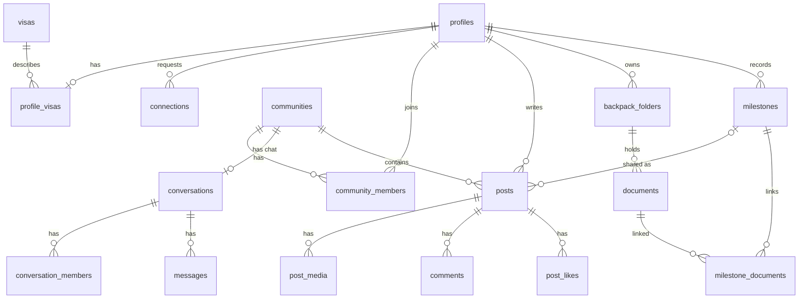

# Arriv — MVP Build Spec

**Version:** 1.0 · 23 November 2026
**Read with:** `docs/arriv-context.md` (product context) and the Arriv design system (visual source of truth).

This spec is the plan for building Arriv v1. Build it in the phase order in section 8. Each phase ends with a working, testable app.

---

## 1. MVP scope

### In v1
| Area | What ships |
|---|---|
| Sign-up & onboarding | Email + password, Google, Apple. Onboarding builds the user's "boarding pass": origin country, arrival date, current visa, city, then suggested communities to join |
| Profile | Passport-style profile, bio, origin, city, visa status with visibility control (public / connections / private), connections |
| Communities | Browse (departures board), search, filter, join/leave, create. Community page with its posts and chat |
| Feed | Home feed of posts from joined communities, connections and the user's own posts. Post types: post, question, journey update. Images, likes, comments |
| Chat | 1:1 direct messages, small group chats, and one chat room per community. Text, images, files. Pinned "Customs notice" disclaimer in group and community chats |
| My Backpack | Private document drive: default folders, upload (camera, photos, files), view, rename, move, delete. **Only the owner can ever read a Backpack file in v1** |
| My Journey | Milestones as passport stamps (done or upcoming), notes, linked Backpack documents, reminders (e.g. visa expiry), share a milestone to the feed as a journey update |
| Visa guide | Simplified visa "tickets" by category, entered by an admin, each linking to the official Home Affairs page. Placeholder text for fees and times until checked |
| Safety | Report posts/comments/messages/users/communities, block users, basic admin moderation, account deletion in the app |
| Notifications | Push + in-app: new message, reply, comment, like, connection request, community join (owner), milestone reminder |

### Not in v1 (designed for, built later)
- Lawyers and agents: accounts, verification, directory, reviews, document sharing with clients
- Payments and tiers (every user is `free` in v1; the field exists)
- Translations (English only, but all strings go through i18n from day one)
- Phone sign-in, video, voice messages, stories, search across everything

### Principles for the build
1. **Security in the database.** Every table has Row Level Security (RLS). The app never decides who can see what on its own.
2. **Private by default.** Backpack files, visa expiry dates, notes and reminders are visible only to their owner.
3. **No advice.** Disclaimers on group chats and the visa guide; official info always links to Home Affairs.
4. **Design system first.** Screens are built from the shared components, never one-off styles.
5. **One codebase.** iOS, Android and web from the same Expo app. Test mobile web as its own platform.

---

## 2. Main user journeys (v1)

1. **New arrival joins.** Welcome → sign up (Apple/Google/email) → onboarding: "Where are you flying from?" (origin), "When did you land?" (arrival date), "What visa are you on?" (subclass, optional, with visibility choice), city → suggested communities (city, visa type, language) → Home with their boarding pass.
2. **Asks a question.** Home or a community → ＋ → Question → choose community → post. Gets comments; notified on replies.
3. **Chats with the crew.** Communities → Departures board → community → Join → community chat (sees Customs notice) → DMs another member.
4. **Packs documents.** Backpack → Upload → picks folder (Identity, Visas, Police checks…) → file stored privately.
5. **Records a milestone.** Journey → Add stamp → "Visa granted", date, links grant letter from Backpack → optionally shares a journey update (without the document) to a community.
6. **Gets a reminder.** Adds upcoming milestone "Visa expires" with reminder date → push notification on that date.
7. **Reports something.** Long-press post/message → Report → reason → admin reviews.
8. **Leaves.** Settings → Delete account → all their data and files are removed.

---

## 3. Data model (Supabase Postgres)

Conventions: `snake_case`; `id uuid primary key default gen_random_uuid()` unless noted; `created_at timestamptz default now()`; `updated_at` via trigger where edited; soft delete (`deleted_at`) only where noted. All foreign keys to users point at `profiles(id)`, which equals `auth.users(id)`.

### 3.1 Enums
| Enum | Values |
|---|---|
| `visibility` | `public`, `connections`, `private` |
| `user_role` | `user`, `admin` |
| `tier` | `free`, `member`, `professional` (only `free` used in v1) |
| `community_kind` | `city`, `visa`, `language`, `culture`, `interest` |
| `member_role` | `owner`, `moderator`, `member` |
| `post_kind` | `post`, `question`, `journey_update` |
| `conversation_kind` | `direct`, `group`, `community` |
| `connection_status` | `pending`, `accepted` |
| `folder_kind` | `identity`, `visa`, `police`, `education`, `work`, `health`, `other` |
| `milestone_kind` | `visa`, `arrival`, `education`, `work`, `home`, `pr`, `citizenship`, `other` |
| `milestone_status` | `done`, `upcoming` |
| `visa_category` | `work`, `study`, `family`, `visitor`, `humanitarian`, `other` |
| `stay_type` | `permanent`, `temporary`, `provisional` |
| `report_target` | `post`, `comment`, `message`, `profile`, `community` |
| `report_status` | `open`, `actioned`, `dismissed` |

### 3.2 People
**`profiles`**: public identity (1 row per user, created by trigger on `auth.users` insert)
| Column | Type | Notes |
|---|---|---|
| id | uuid PK | = `auth.users.id`, on delete cascade |
| handle | citext unique | 3–20 chars, `[a-z0-9_]` |
| display_name | text | |
| avatar_path | text null | path in `avatars` bucket |
| bio | text null | ≤ 300 chars |
| origin_country | char(2) null | ISO 3166-1 alpha-2 (e.g. `BR`) |
| city | text null | e.g. `Sydney` |
| arrived_on | date null | drives "Day 412" |
| role | user_role | default `user` |
| tier | tier | default `free` |
| locale | text | default `en` |
| onboarded_at | timestamptz null | null until onboarding finished |
| created_at, updated_at | timestamptz | |

**`profile_visas`**: visa shown on profile, kept separate so RLS can hide it
| Column | Type | Notes |
|---|---|---|
| user_id | uuid PK → profiles | |
| visa_subclass | text null → visas.subclass | e.g. `500` |
| visa_label | text null | free text if not in `visas` |
| visibility | visibility | default `connections` |
| updated_at | timestamptz | |

> Visa **expiry** is never stored here. It lives in Journey as an upcoming milestone (owner-only).

**`connections`**
| Column | Type | Notes |
|---|---|---|
| requester_id | uuid → profiles | PK part |
| addressee_id | uuid → profiles | PK part; check requester ≠ addressee |
| status | connection_status | default `pending` |
| created_at, accepted_at | timestamptz | |

**`blocks`**: `blocker_id`, `blocked_id` (PK pair), `created_at`. Blocked users can't see each other's posts, profiles or messages, and can't message.

### 3.3 Communities and feed
**`communities`**
| Column | Type | Notes |
|---|---|---|
| id | uuid PK | |
| slug | citext unique | used in URLs |
| name | text | ≤ 40 chars |
| description | text | |
| kind | community_kind | |
| city | text null | null = Australia-wide ("Gate AU") |
| language | text null | e.g. `es` |
| visa_subclass | text null | for visa crews |
| tags | text[] | |
| stamp_color | text | design token name (`tangerine`, `sky`, …) |
| is_private | boolean | default false (v1 UI: public only) |
| member_count | int | maintained by trigger |
| created_by | uuid → profiles | |
| created_at | timestamptz | |

**`community_members`**: `community_id`, `user_id` (PK pair), `role member_role default 'member'`, `joined_at`.
Creating a community adds the creator as `owner` and creates its `community` conversation (trigger).

**`posts`**
| Column | Type | Notes |
|---|---|---|
| id | uuid PK | |
| author_id | uuid → profiles | |
| community_id | uuid null → communities | null = profile post |
| kind | post_kind | |
| body | text | 1–2000 chars |
| milestone_id | uuid null → milestones | for journey updates; shows the stamp, never the documents |
| like_count, comment_count | int | triggers |
| created_at, edited_at, deleted_at | timestamptz | soft delete |

**`post_media`**: `id`, `post_id`, `storage_path` (bucket `post-media`), `width`, `height`, `position`. Max 4 images per post.

**`comments`**: `id`, `post_id`, `author_id`, `parent_id` (null = top level; one level of replies), `body` ≤ 1000, `created_at`, `deleted_at`.

**`post_likes`**: `post_id`, `user_id` (PK pair), `created_at`.

### 3.4 Chat
**`conversations`**
| Column | Type | Notes |
|---|---|---|
| id | uuid PK | |
| kind | conversation_kind | |
| community_id | uuid null unique → communities | set for `community` kind |
| title | text null | groups only |
| created_by | uuid → profiles | |
| last_message_at | timestamptz | trigger, for sorting the inbox |
| created_at | timestamptz | |

**`conversation_members`**: `conversation_id`, `user_id` (PK pair), `role member_role`, `last_read_at`, `muted boolean default false`, `joined_at`.
- `direct`: exactly 2 members; one direct conversation per pair (create via RPC `get_or_create_direct(other_user)`).
- `community`: membership mirrors `community_members` (trigger on join/leave).
- `group`: up to 50 members, created by a user.

**`messages`**
| Column | Type | Notes |
|---|---|---|
| id | bigint identity PK | ordered |
| conversation_id | uuid → conversations | index (conversation_id, id desc) |
| sender_id | uuid → profiles | |
| body | text null | ≤ 4000 |
| attachment_path | text null | bucket `chat-attachments` |
| attachment_name, attachment_mime | text null | |
| created_at, edited_at, deleted_at | timestamptz | |

> **Sharing from Backpack** into chat makes a **copy** in `chat-attachments` after the user confirms ("This file will be visible to everyone in this chat"). Backpack files themselves are never readable by others in v1.

### 3.5 My Backpack
**`backpack_folders`**: `id`, `owner_id`, `name`, `kind folder_kind`, `position int`, `created_at`. Six default folders created at sign-up: Identity, Visas, Police checks, Education, Work, Other.

**`documents`**
| Column | Type | Notes |
|---|---|---|
| id | uuid PK | |
| owner_id | uuid → profiles | |
| folder_id | uuid → backpack_folders | |
| name | text | user-editable display name |
| storage_path | text | `backpack/{owner_id}/{document_id}` |
| mime_type | text | allow: pdf, jpg, png, heic, docx |
| size_bytes | bigint | max 20 MB per file |
| uploaded_by | uuid → profiles | = owner in v1; lawyers later |
| created_at, updated_at | timestamptz | |

Hard delete: deleting a document removes the row and the storage object (Edge Function or trigger + storage API).

### 3.6 My Journey
**`milestones`**
| Column | Type | Notes |
|---|---|---|
| id | uuid PK | |
| user_id | uuid → profiles | |
| kind | milestone_kind | picks the stamp style |
| title | text | e.g. "Student visa granted" |
| status | milestone_status | `done` or `upcoming` |
| happened_on | date null | for `done` |
| due_on | date null | for `upcoming` (e.g. visa expiry) |
| remind_on | date null | push reminder date |
| visa_subclass | text null | shown on visa stamps |
| place | text null | e.g. "SYD" on arrival stamp |
| notes | text null | private, ≤ 2000 |
| visibility | visibility | default `private` (controls who sees the stamp on the profile) |
| created_at, updated_at | timestamptz | |

**`milestone_documents`**: `milestone_id`, `document_id` (PK pair). Both must belong to the same user (check in RLS).

### 3.7 Visa guide
**`visas`**: admin-managed reference content
| Column | Type | Notes |
|---|---|---|
| subclass | text PK | `189`, `500`… |
| name | text | "Skilled Independent" |
| category | visa_category | |
| summary | text | one line, plain English |
| stay_type | stay_type | |
| key_points | text[] | short eligibility points |
| processing_note | text null | shown as text, e.g. "Check Home Affairs" until verified |
| fee_note | text null | same |
| official_url | text | Home Affairs page |
| last_checked_on | date null | shown as "Checked on …" |
| is_published | boolean | default false |

### 3.8 Safety and system
**`reports`**: `id`, `reporter_id`, `target_type report_target`, `target_id text`, `reason text` (spam, harassment, scam, false information, other), `details text null`, `status report_status default 'open'`, `created_at`, `resolved_by`, `resolved_at`.

**`notifications`**: `id`, `user_id`, `type text` (message, comment, reply, like, connection_request, connection_accepted, community_join, milestone_reminder), `actor_id null`, `entity_type text`, `entity_id text`, `read_at null`, `created_at`.

**`push_tokens`**: `user_id`, `token text unique`, `platform text` (ios, android, web), `updated_at`.

### 3.9 Later (do not build in v1, but don't block)
- `professionals` (user_id, kind agent/lawyer, registration_number, firm, specialties, languages, verified_at, verified_by)
- `reviews` (professional_id, author_id, rating 1–5, body, client_confirmed_at)
- `document_shares` (document_id, shared_with, permission, expires_at): lets an agent read a client's file
- `subscriptions` (user_id, provider `revenuecat`, product_id, status, expires_at), fed by a RevenueCat webhook that updates `profiles.tier`

### 3.10 Relationships (overview)



---

## 4. Access rules (Row Level Security)

Helper SQL functions (`security definer`, `stable`, in a private schema):
- `is_admin()`: current user's `profiles.role = 'admin'`
- `are_connected(a uuid, b uuid)`: an `accepted` connection exists either way
- `is_blocked(a uuid, b uuid)`: a block exists either way
- `is_community_member(c uuid)`, `is_conversation_member(conv uuid)`

| Table | Read | Write |
|---|---|---|
| profiles | Any signed-in user, unless blocked | Own row only (not `role`, `tier`) |
| profile_visas | Owner; or `public`; or `connections` and connected. Never if blocked | Own row |
| connections | Either party | Insert as requester; addressee accepts; either deletes |
| blocks | Blocker only | Own rows |
| communities | Any signed-in user | Insert: any user (becomes owner). Update: owner/moderator. Delete: owner/admin |
| community_members | Any signed-in user (member lists) | Join/leave self; owner/moderator can remove |
| posts | Not deleted, not blocked, and: community post → anyone signed in (members only if private); profile post → anyone signed in | Insert: author = self, and member of community if set. Update/soft-delete: author; moderators of that community; admin |
| post_media, comments, post_likes | Same as the parent post | Own rows; comments need read access to the post |
| conversations | Members only | Insert via RPC only |
| conversation_members | Members of that conversation | Via RPC/triggers; self can leave, update own `last_read_at`/`muted` |
| messages | Members only, not deleted, not from a blocked user | Insert: sender = self and member; edit/delete own |
| backpack_folders, documents | **Owner only** | **Owner only** |
| milestones | Owner; others only the stamp fields if `visibility` allows (expose via a view `public_milestones` without notes/dates of upcoming items) | Owner only |
| milestone_documents | Owner only | Owner only, both rows owned |
| visas | Signed-in users read `is_published`; admin reads all | Admin only |
| reports | Reporter reads own; admin reads all | Insert: any signed-in user; update: admin |
| notifications | Owner | System (service role / triggers); owner updates `read_at` |
| push_tokens | Owner | Owner |

---

## 5. File storage (Supabase Storage)

| Bucket | Public? | Path | Who can read | Who can write |
|---|---|---|---|---|
| `avatars` | Public read | `{user_id}/{file}` | Anyone | Owner |
| `post-media` | Private | `{post_id}/{file}` | Whoever can read the post (signed URLs) | Post author |
| `chat-attachments` | Private | `{conversation_id}/{message_uuid}-{name}` | Conversation members (signed URLs) | Members |
| `backpack` | Private | `{owner_id}/{document_id}` | **Owner only** | **Owner only** |

- Signed URLs expire after 5 minutes for `backpack` and 1 hour elsewhere.
- Strip location (EXIF) data from photos before upload.
- Limits: images 10 MB, files 20 MB.
- Later: consider client-side encryption for Backpack files.

---

## 6. Server-side logic

**Database triggers**
- New auth user → create `profiles`, `profile_visas`, default `backpack_folders`
- Community created → owner membership + community conversation
- Join/leave community → mirror into conversation members, update `member_count`
- Likes/comments → update counts; create `notifications`
- New message → update `last_message_at`; notify members (not the sender, not muted)

**RPC functions (Postgres)**
- `get_home_feed(cursor timestamptz, limit int)`: posts from joined communities, connections and self, newest first, blocks excluded
- `get_or_create_direct(other_user uuid)`: returns the direct conversation id
- `create_group(title text, member_ids uuid[])`
- `suggest_communities()`: by city, visa subclass, origin/language

**Edge Functions**
- `send-push`: sends Expo push notifications for new notifications
- `milestone-reminders`: daily cron; notifies users whose `remind_on` = today
- `delete-account`: deletes storage files then the auth user (cascades)
- `delete-document`: removes the storage object with the row

**Realtime**
- Subscribe to `messages` for open conversations and the inbox; `notifications` for the badge. RLS applies to Realtime.

---

## 7. App structure (Expo Router)

```
arriv/
├─ app/
│  ├─ _layout.tsx                 # providers: Supabase session, TanStack Query, fonts, i18n
│  ├─ (auth)/
│  │  ├─ welcome.tsx              # boarding pass welcome
│  │  ├─ sign-in.tsx
│  │  └─ sign-up.tsx
│  ├─ (onboarding)/
│  │  ├─ origin.tsx · arrival.tsx · visa.tsx · city.tsx · communities.tsx
│  ├─ (tabs)/
│  │  ├─ _layout.tsx              # TabBar: Home, Communities, ＋, Chat, Backpack
│  │  ├─ index.tsx                # Home feed + boarding pass
│  │  ├─ communities.tsx          # Departures board
│  │  ├─ create.tsx               # opens the composer modal
│  │  ├─ chat.tsx                 # inbox
│  │  └─ backpack.tsx             # luggage tags
│  ├─ community/[slug].tsx
│  ├─ post/[id].tsx
│  ├─ conversation/[id].tsx
│  ├─ backpack/[folderId].tsx · document/[id].tsx
│  ├─ journey/index.tsx · journey/[id].tsx
│  ├─ visas/index.tsx · visas/[subclass].tsx
│  ├─ profile/[handle].tsx
│  ├─ compose.tsx                 # modal: post / question / journey update
│  └─ settings/ (index, account, privacy, notifications, delete)
├─ src/
│  ├─ theme/tokens.ts             # from the design system tokens
│  ├─ components/ds/              # Button, Stamp, Postmark, BoardingPass, Postcard,
│  │                              # DepartureRow, LuggageTag, TabBar, Text, Input…
│  ├─ features/                   # one folder per area: api.ts (queries), hooks, components
│  │  ├─ auth/ feed/ communities/ chat/ backpack/ journey/ visas/ profile/ safety/
│  ├─ lib/ supabase.ts · storage.ts · notifications.ts
│  ├─ i18n/ en.json
│  └─ types/database.ts           # generated by `supabase gen types`
├─ supabase/
│  ├─ migrations/                 # one SQL file per change
│  ├─ seed.sql                    # demo users, communities, visas
│  └─ functions/                  # Edge Functions
├─ docs/                          # this spec + context
└─ CLAUDE.md
```

**Libraries**
- Expo SDK (latest stable), Expo Router, TypeScript (strict)
- `@supabase/supabase-js`, `expo-secure-store` (session)
- TanStack Query (server data), Zustand (small UI state only)
- react-hook-form + zod (forms and validation)
- react-native-svg (stamps, tags, perforations), `@expo-google-fonts/nunito`, `@expo-google-fonts/dm-mono`
- expo-image, expo-image-picker, expo-document-picker, expo-image-manipulator (strip EXIF, resize)
- expo-notifications, expo-localization + i18next
- Testing: Jest + React Native Testing Library; pgTAP or SQL tests for RLS

---

## 8. Build phases

Each phase: migrations → RLS → generated types → screens → tests. Don't start the next phase until the current one works on iOS, Android and web.

| # | Phase | Done when |
|---|---|---|
| 0 | **Foundation:** Expo app, Supabase project (Sydney region), CLI + local dev, env vars, tokens + fonts, design-system components, lint/format, CI | The components render on all 3 platforms; a Storybook-like "DS" screen shows them |
| 1 | **Auth + onboarding + profile:** email, Google, Apple; onboarding flow; profile + visa visibility; connections; blocks | A new user can sign up, finish onboarding and see their boarding pass and profile |
| 2 | **Communities + feed:** departures board, create/join, community page, composer, posts, images, likes, comments, home feed | Two test users in the same community see each other's posts and comments |
| 3 | **Chat:** inbox, direct, group, community chat, attachments, read state, Customs notice, realtime | Messages arrive live; non-members can't read them (RLS test) |
| 4 | **Backpack:** folders, upload, view, rename, move, delete, share-a-copy to chat | Another user can't read a file even with its path (RLS + storage test) |
| 5 | **Journey:** stamps, upcoming items, linked documents, reminders, share to feed | A reminder push arrives on the set date; shared update shows the stamp only |
| 6 | **Visa guide:** admin entry (Supabase dashboard is fine), list, detail, official link, disclaimer | Published visas show; unpublished don't |
| 7 | **Safety + notifications:** reports, admin review, push + in-app notifications, delete account | Reported content can be removed; account deletion removes files |
| 8 | **Launch prep:** privacy policy, terms, app icons, store listings, TestFlight + Play internal testing, web deploy | Testers install from TestFlight / Play and the web URL |

---

## 9. Open questions (decide before the phase that needs them)
- Community chat for large communities: one room, or threads per topic? (Phase 3)
- Can anyone create a community, or only after X days / admin approval? (Phase 2)
- Moderation: who are the first moderators; response time target? (Phase 7)
- Legal review of the "not advice" wording and privacy policy before launch (Phase 8)
- Home Affairs content: manual entry vs. a tool to flag pages that changed (after v1)
