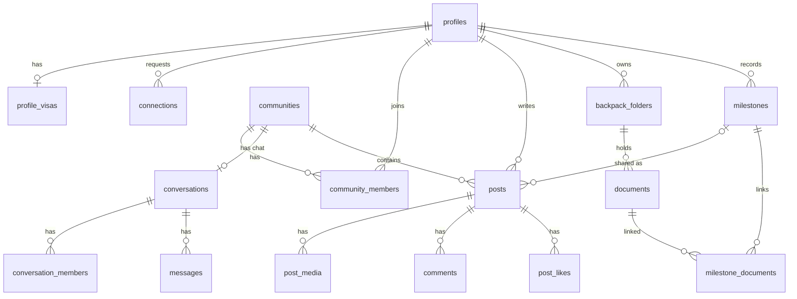

# Arriv — MVP Build Spec

**Version:** 1.0 · 23 November 2026
**Read with:** `docs/arriv-context.md` (product context) and the Arriv design system (visual source of truth).

This spec is the plan for building Arriv v1. Build it in the phase order in section 8. Each phase ends with a working, testable app.

---

## 1. MVP scope

### In v1
| Area | What ships |
|---|---|
| Sign-up & onboarding | Email + password, Google, Apple. Onboarding builds the user's "boarding pass": origin country, arrival date, current visa, city, then suggested communities to join |
| Profile | Passport-style profile, bio, origin, city, visa status with visibility control (public / connections / private), connections |
| Communities | Browse (departures board), search, filter, join/leave, create. Community page with its posts and chat |
| Feed | Home feed of posts from joined communities, connections and the user's own posts. Post types: post, question, journey update. Images, likes, comments |
| Chat | 1:1 direct messages, small group chats, and one chat room per community. Text, images, files. Pinned "Customs notice" disclaimer in group and community chats |
| My Backpack | Private document drive: default folders, upload (camera, photos, files), view, rename, move, delete. **Only the owner can ever read a Backpack file in v1** |
| My Journey | Milestones as passport stamps (done or upcoming), notes, linked Backpack documents, reminders (e.g. visa expiry), share a milestone to the feed as a journey update |
| Safety | Report posts/comments/messages/users/communities, block users, basic admin moderation, account deletion in the app |
| Notifications | Push + in-app: new message, reply, comment, like, connection request, community join (owner), milestone reminder |

### Not in v1 (designed for, built later)
- Lawyers and agents: accounts, verification, directory, reviews, document sharing with clients
- Payments and tiers (every user is `free` in v1; the field exists)
- Translations (English only, but all strings go through i18n from day one)
- Phone sign-in, video, voice messages, stories, search across everything
- A visa guide (removed from v1 on 26 Nov 2026: visa details change often and there's no official source to pull them from; see §9)

### Principles for the build
1. **Security in the database.** Every table has Row Level Security (RLS). The app never decides who can see what on its own.
2. **Private by default.** Backpack files, visa expiry dates, notes and reminders are visible only to their owner.
3. **No advice.** Disclaimers on group and community chats; for official information, people go to Home Affairs.
4. **Design system first.** Screens are built from the shared components, never one-off styles.
5. **One codebase.** iOS, Android and web from the same Expo app. Test mobile web as its own platform.

---

## 2. Main user journeys (v1)

1. **New arrival joins.** Welcome → sign up (Apple/Google/email) → onboarding: "Where are you flying from?" (origin), "When did you land?" (arrival date), "What visa are you on?" (subclass, optional, with visibility choice), city → suggested communities (city, visa type, language) → Home with their boarding pass.
2. **Asks a question.** Home or a community → ＋ → Question → choose community → post. Gets comments; notified on replies.
3. **Chats with the crew.** Communities → Departures board → community → Join → community chat (sees Customs notice) → DMs another member.
4. **Packs documents.** Backpack → Upload → picks folder (Identity, Visas, Police checks…) → file stored privately.
5. **Records a milestone.** Journey → Add stamp → "Visa granted", date, links grant letter from Backpack → optionally shares a journey update (without the document) to a community.
6. **Gets a reminder.** Adds upcoming milestone "Visa expires" with reminder date → push notification on that date.
7. **Reports something.** Long-press post/message → Report → reason → admin reviews.
8. **Leaves.** Settings → Delete account → for each community they own: delete it, or hand it to another member → all their data and files are removed. Communities they handed over stay.

---

## 3. Data model (Supabase Postgres)

Conventions: `snake_case`; `id uuid primary key default gen_random_uuid()` unless noted; `created_at timestamptz default now()`; `updated_at` via trigger where edited; soft delete (`deleted_at`) only where noted. All foreign keys to users point at `profiles(id)`, which equals `auth.users(id)`.

### 3.1 Enums
| Enum | Values |
|---|---|
| `visibility` | `public`, `connections`, `private` |
| `user_role` | `user`, `admin` |
| `tier` | `free`, `member`, `professional` (only `free` used in v1) |
| `community_kind` | `city`, `visa`, `language`, `culture`, `interest` |
| `member_role` | `owner`, `moderator`, `member` |
| `post_kind` | `post`, `question`, `journey_update` |
| `conversation_kind` | `direct`, `group`, `community` |
| `connection_status` | `pending`, `accepted` |
| `folder_kind` | `identity`, `visa`, `police`, `education`, `work`, `health`, `other` |
| `milestone_kind` | `visa`, `arrival`, `education`, `work`, `home`, `pr`, `citizenship`, `other` |
| `milestone_status` | `done`, `upcoming` |
| `report_target` | `post`, `comment`, `message`, `profile`, `community` |
| `report_status` | `open`, `actioned`, `dismissed` |

### 3.2 People
**`profiles`**: public identity (1 row per user, created by trigger on `auth.users` insert)
| Column | Type | Notes |
|---|---|---|
| id | uuid PK | = `auth.users.id`, on delete cascade |
| handle | citext unique | 3–20 chars, `[a-z0-9_]` |
| display_name | text | |
| avatar_path | text null | path in `avatars` bucket |
| bio | text null | ≤ 300 chars |
| origin_country | char(2) null | ISO 3166-1 alpha-2 (e.g. `BR`) |
| city | text null | e.g. `Sydney` |
| arrived_on | date null | drives "Day 412" |
| role | user_role | default `user` |
| tier | tier | default `free` |
| locale | text | default `en` |
| onboarded_at | timestamptz null | null until onboarding finished |
| created_at, updated_at | timestamptz | |

**`profile_visas`**: visa shown on profile, kept separate so RLS can hide it
| Column | Type | Notes |
|---|---|---|
| user_id | uuid PK → profiles | |
| visa_subclass | text null | e.g. `500` |
| visa_label | text null | free text, e.g. a visa name |
| visibility | visibility | default `connections` |
| updated_at | timestamptz | |

> Visa **expiry** is never stored here. It lives in Journey as an upcoming milestone (owner-only).

**`connections`**
| Column | Type | Notes |
|---|---|---|
| requester_id | uuid → profiles | PK part |
| addressee_id | uuid → profiles | PK part; check requester ≠ addressee |
| status | connection_status | default `pending` |
| created_at, accepted_at | timestamptz | |

**`blocks`**: `blocker_id`, `blocked_id` (PK pair), `created_at`. Blocked users can't see each other's posts, profiles or messages, and can't message.

### 3.3 Communities and feed
**`communities`**
| Column | Type | Notes |
|---|---|---|
| id | uuid PK | |
| slug | citext unique | used in URLs |
| name | text | ≤ 40 chars |
| description | text | |
| kind | community_kind | |
| city | text null | null = Australia-wide ("Gate AU") |
| language | text null | e.g. `es` |
| visa_subclass | text null | for visa crews |
| tags | text[] | |
| stamp_color | text | design token name (`tangerine`, `sky`, …) |
| is_private | boolean | default false (v1 UI: public only) |
| member_count | int | maintained by trigger |
| created_by | uuid → profiles | null once the creator's account is deleted. Who is in charge is the `owner` member, not `created_by` |
| created_at | timestamptz | |

**`community_members`**: `community_id`, `user_id` (PK pair), `role member_role default 'member'`, `joined_at`.
Creating a community adds the creator as `owner` and creates its `community` conversation (trigger).

**`posts`**
| Column | Type | Notes |
|---|---|---|
| id | uuid PK | |
| author_id | uuid → profiles | |
| community_id | uuid null → communities | null = profile post |
| kind | post_kind | |
| body | text | 1–2000 chars |
| milestone_id | uuid null → milestones | for journey updates; `stamp jsonb` holds the stamp's face, filled by the database |
| like_count, comment_count | int | triggers |
| created_at, edited_at, deleted_at | timestamptz | soft delete |

**`post_media`**: `id`, `post_id`, `storage_path` (bucket `post-media`), `width`, `height`, `position`. Max 4 images per post.

**`comments`**: `id`, `post_id`, `author_id`, `parent_id` (null = top level; one level of replies), `body` ≤ 1000, `created_at`, `deleted_at`.

**`post_likes`**: `post_id`, `user_id` (PK pair), `created_at`.

### 3.4 Chat
**`conversations`**
| Column | Type | Notes |
|---|---|---|
| id | uuid PK | |
| kind | conversation_kind | |
| community_id | uuid null unique → communities | set for `community` kind |
| title | text null | groups only |
| created_by | uuid → profiles | null once the creator's account is deleted (the chat stays) |
| last_message_at | timestamptz | trigger, for sorting the inbox |
| created_at | timestamptz | |

**`conversation_members`**: `conversation_id`, `user_id` (PK pair), `role member_role`, `last_read_at`, `muted boolean default false`, `joined_at`.
- `direct`: exactly 2 members; one direct conversation per pair (create via RPC `get_or_create_direct(other_user)`).
- `community`: membership mirrors `community_members` (trigger on join/leave).
- `group`: up to 50 members (pending invites count), created by a user. Adding someone is an invite they accept or decline (`conversation_invites`). If the owner leaves, the longest-standing member becomes owner; an empty group is removed.

**`conversation_invites`**: `conversation_id`, `invitee_id` (PK pair), `invited_by`, `created_at`. Invitees see the group's name, not its messages or members, until they accept.

**`messages`**
| Column | Type | Notes |
|---|---|---|
| id | bigint identity PK | ordered |
| conversation_id | uuid → conversations | index (conversation_id, id desc) |
| sender_id | uuid → profiles | |
| body | text null | ≤ 4000 |
| attachment_path | text null | bucket `chat-attachments` |
| attachment_name, attachment_mime | text null | |
| created_at, edited_at, deleted_at | timestamptz | |

> **Sharing from Backpack** into chat makes a **copy** in `chat-attachments` after the user confirms ("This file will be visible to everyone in this chat"). Backpack files themselves are never readable by others in v1.

### 3.5 My Backpack
**`backpack_folders`**: `id`, `owner_id`, `name`, `kind folder_kind`, `position int`, `created_at`. Six default folders created at sign-up: Identity, Visas, Police checks, Education, Work, Other. Default folders have a `kind` and can be renamed but not deleted; `name` stays null until renamed, so the app shows the translated default name. Folders people add have no `kind`, need a `name`, and can be deleted once empty. At most 30 folders each.

**`documents`**
| Column | Type | Notes |
|---|---|---|
| id | uuid PK | |
| owner_id | uuid → profiles | |
| folder_id | uuid → backpack_folders | one of the owner's own folders (composite FK on `folder_id, owner_id`) |
| name | text | user-editable display name |
| storage_path | text | `{owner_id}/{document_id}` in the `backpack` bucket |
| mime_type | text | allow: pdf, jpg, png, webp, heic, docx. Copied from the stored file on insert |
| size_bytes | bigint | max 20 MB per file. Copied from the stored file on insert |
| uploaded_by | uuid → profiles | = owner in v1; lawyers later |
| created_at, updated_at | timestamptz | |

Upload: the app picks the document id, uploads to `{owner_id}/{id}`, then inserts the row; a row can't be added without its file. Hard delete: the app deletes the row, then the storage object, both under owner-only rules (no service role needed). Photos are re-encoded before upload, which strips EXIF location.

### 3.6 My Journey
**`milestones`**
| Column | Type | Notes |
|---|---|---|
| id | uuid PK | |
| user_id | uuid → profiles | |
| kind | milestone_kind | picks the stamp style |
| title | text | e.g. "Student visa granted" |
| status | milestone_status | `done` or `upcoming` |
| happened_on | date null | for `done` |
| due_on | date null | for `upcoming` (e.g. visa expiry) |
| remind_on | date null | push reminder date |
| visa_subclass | text null | shown on visa stamps |
| place | text null | e.g. "SYD" on arrival stamp |
| notes | text null | private, ≤ 2000 |
| visibility | visibility | default `private` (controls who sees the stamp on the profile) |
| created_at, updated_at | timestamptz | |

Rules: a done stamp has `happened_on` (no due or reminder date); an upcoming item has `due_on`, and `remind_on` (if set) is on or before it. `reminded_at` records when the reminder was sent and is cleared when `remind_on` changes. Others never read this table: `get_stamps(user)` returns only done stamps' faces (kind, title, date, subclass, place) as their visibility allows, never notes, upcoming items or reminders.

**`milestone_documents`**: `milestone_id`, `document_id`, `user_id` (PK on the pair). Composite foreign keys make both belong to the same user; owner-only RLS.

**Journey updates**: `posts.milestone_id` plus `posts.stamp jsonb`, a snapshot of the stamp's face that the database fills when the post is made (only from the author's own done stamp). Readers see the stamp, never the milestone row or its documents.

### 3.7 Visa guide (removed from v1)
Removed on 26 Nov 2026 (see §9). There is no `visas` table. The work-in-progress version (tickets, admin entry, Home Affairs links) is kept in a local git stash named "Phase 6 visa guide (removed from v1…)" in case it returns.

### 3.8 Safety and system
**`reports`**: `id`, `reporter_id`, `target_type report_target`, `target_id text`, `target_user_id` (who wrote/owns it), `reason text` (spam, harassment, scam, false_information, other), `details text null`, `snapshot jsonb`, `status report_status default 'open'`, `created_at`, `resolved_by`, `resolved_at`. The database checks the reporter could see the thing, records who reported and takes a snapshot (so admins can judge a message in a chat they're not in, or something later edited). One open report per person per thing; nobody can report themselves. Admins resolve with `resolve_report(report, remove)`: remove (post, comment, message, community) or dismiss; all open reports about the same thing close together.

**`notifications`**: `id`, `user_id`, `type text` (message, comment, reply, like, connection_request, connection_accepted, community_join, milestone_reminder), `actor_id null`, `entity_type text`, `entity_id text`, `preview text null`, `read_at null`, `created_at`. Written only by database triggers. Chat messages are push only (no row).

**`notification_settings`**: one row per person (missing = all on): `messages`, `comments` (and replies), `likes`, `connections`, `community_joins`, `reminders`. Controls pushes only; the in-app list shows everything.

**`push_tokens`**: `token` (PK), `user_id`, `platform text` (ios, android), `updated_at`. Claimed through `register_push_token`.

### 3.9 Later (do not build in v1, but don't block)
- `professionals` (user_id, kind agent/lawyer, registration_number, firm, specialties, languages, verified_at, verified_by)
- `reviews` (professional_id, author_id, rating 1–5, body, client_confirmed_at)
- `document_shares` (document_id, shared_with, permission, expires_at): lets an agent read a client's file
- `subscriptions` (user_id, provider `revenuecat`, product_id, status, expires_at), fed by a RevenueCat webhook that updates `profiles.tier`

### 3.10 Relationships (overview)



---

## 4. Access rules (Row Level Security)

Helper SQL functions (`security definer`, `stable`, in a private schema):
- `is_admin()`: current user's `profiles.role = 'admin'`
- `are_connected(a uuid, b uuid)`: an `accepted` connection exists either way
- `is_blocked(a uuid, b uuid)`: a block exists either way
- `is_community_member(c uuid)`, `is_conversation_member(conv uuid)`

| Table | Read | Write |
|---|---|---|
| profiles | Any signed-in user, unless blocked | Own row only (not `role`, `tier`) |
| profile_visas | Owner; or `public`; or `connections` and connected. Never if blocked | Own row |
| connections | Either party | Insert as requester; addressee accepts; either deletes |
| blocks | Blocker only | Own rows |
| communities | Any signed-in user | Insert: any user (becomes owner). Update: owner/moderator. Delete: current owner/admin. Ownership moves only via `transfer_community_ownership` |
| community_members | Any signed-in user (member lists) | Join/leave self; owner/moderator can remove |
| posts | Not deleted, not blocked, and: community post → anyone signed in (members only if private); profile post → anyone signed in | Insert: author = self, and member of community if set. Update/soft-delete: author; moderators of that community; admin |
| post_media, comments, post_likes | Same as the parent post | Own rows; comments need read access to the post |
| conversations | Members only | Insert via RPC only |
| conversation_members | Members of that conversation | Via RPC/triggers; self can leave, update own `last_read_at`/`muted` |
| conversation_invites | Invitee; members of that group | Via RPC; invitee declines, inviter or group owner/moderator cancels |
| messages | Members only, not deleted, not from a blocked user | Insert: sender = self and member; edit/delete own |
| backpack_folders, documents | **Owner only** | **Owner only** |
| milestones | Owner only; others see done stamps' faces through `get_stamps()` if `visibility` allows | Owner only |
| milestone_documents | Owner only | Owner only, both rows owned |
| reports | Reporter reads own; admin reads all (the reported person never sees reports) | Insert: any signed-in user, only what they can see; resolve: admin via `resolve_report` |
| notifications | Owner | System (service role / triggers); owner updates `read_at` |
| push_tokens | Owner | Via `register_push_token`; owner deletes |
| notification_settings | Owner | Owner |

---

## 5. File storage (Supabase Storage)

| Bucket | Public? | Path | Who can read | Who can write |
|---|---|---|---|---|
| `avatars` | Public read | `{user_id}/{file}` | Anyone | Owner |
| `post-media` | Private | `{post_id}/{file}` | Whoever can read the post (signed URLs) | Post author |
| `chat-attachments` | Private | `{conversation_id}/{message_uuid}-{name}` | Conversation members (signed URLs) | Members |
| `backpack` | Private | `{owner_id}/{document_id}` | **Owner only** | **Owner only** |

- Signed URLs expire after 5 minutes for `backpack` and 1 hour elsewhere.
- Strip location (EXIF) data from photos before upload.
- Limits: images 10 MB, files 20 MB.
- Later: consider client-side encryption for Backpack files.

---

## 6. Server-side logic

**Database triggers**
- New auth user → create `profiles`, `profile_visas`, default `backpack_folders`
- Community created → owner membership + community conversation
- Join/leave community → mirror into conversation members, update `member_count`
- Likes/comments → update counts; create `notifications`
- New message → update `last_message_at`; notify members (not the sender, not muted)

**RPC functions (Postgres)**
- `get_home_feed(cursor timestamptz, limit int)`: posts from joined communities, connections and self, newest first, blocks excluded
- `get_or_create_direct(other_user uuid)`: returns the direct conversation id
- `create_group(title text, invitee_ids uuid[])`: creator is owner; everyone else is invited
- `invite_to_group(conversation uuid, user_ids uuid[])`, `respond_to_group_invite(conversation uuid, accept boolean)`
- `get_inbox()`: one row per conversation with last message and unread count
- `transfer_community_ownership(community uuid, new_owner uuid)`: old owner stays as moderator
- `suggest_communities()`: by city, visa subclass, origin/language

**Edge Functions**

**Push (built in Phase 5, in the database)**
- `register_push_token(token, platform)`: a device's Expo token belongs to whoever signed in on it last.
- `private.send_push(user, title, body, data)`: queues one request to Expo's push service for all of a person's devices (pg_net). Phase 7 reuses it for other notifications.
- `milestone-reminders` (pg_cron, every 15 minutes): reminders reach people at 9am in their profile city's time zone on `remind_on`; each one creates a `notifications` row and a push. Missed runs catch up for up to two days.
- `prune-push-tokens` (pg_cron, hourly): removes tokens Expo reports as `DeviceNotRegistered`.
- No Edge Function or service-role key is involved.
- `delete-account` (built in Phase 7): checks the caller's token, refuses (409) while they own a community, removes every file they own (`account_storage_paths`: Backpack, avatar, post photos, chat uploads), then deletes the auth user so the database cascades the rest. The app's Settings → Delete account screen first walks them through handing over or deleting each owned community, then asks them to type DELETE. Deploy with `npx supabase functions deploy delete-account`.

**Realtime**
- Subscribe to `messages` for open conversations and the inbox; `notifications` for the badge. RLS applies to Realtime.

---

## 7. App structure (Expo Router)

```
arriv/
├─ app/
│  ├─ _layout.tsx                 # providers: Supabase session, TanStack Query, fonts, i18n
│  ├─ (auth)/
│  │  ├─ welcome.tsx              # boarding pass welcome
│  │  ├─ sign-in.tsx
│  │  └─ sign-up.tsx
│  ├─ (onboarding)/
│  │  ├─ origin.tsx · arrival.tsx · visa.tsx · city.tsx · communities.tsx
│  ├─ (tabs)/
│  │  ├─ _layout.tsx              # TabBar: Home, Communities, ＋, Chat, Backpack
│  │  ├─ index.tsx                # Home feed + boarding pass
│  │  ├─ communities.tsx          # Departures board
│  │  ├─ create.tsx               # opens the composer modal
│  │  ├─ chat.tsx                 # inbox
│  │  └─ backpack.tsx             # luggage tags
│  ├─ community/[slug].tsx
│  ├─ post/[id].tsx
│  ├─ conversation/[id].tsx
│  ├─ folder/[id].tsx · document/[id] (index, send) · backpack-upload.tsx
│  ├─ conversation/[id]/backpack.tsx   # send a Backpack copy from the composer
│  ├─ journey/index.tsx · journey/[id] (index, edit, documents)
│  ├─ new-stamp/ (kind, when, details, remind | visibility, notes)   # full-screen wizard
│  ├─ profile/[handle]/journey.tsx   # someone else's stamps, as they allow
│  ├─ profile/[handle]/index.tsx
│  ├─ compose.tsx                 # modal: post / question / journey update
│  └─ settings/ (index, account, privacy, notifications, delete)
├─ src/
│  ├─ theme/tokens.ts             # from the design system tokens
│  ├─ components/ds/              # Button, Stamp, Postmark, BoardingPass, Postcard,
│  │                              # DepartureRow, LuggageTag, TabBar, Text, Input…
│  ├─ features/                   # one folder per area: api.ts (queries), hooks, components
│  │  ├─ auth/ feed/ communities/ chat/ backpack/ journey/ profile/ safety/
│  ├─ lib/ supabase.ts · storage.ts · notifications.ts
│  ├─ i18n/ en.json
│  └─ types/database.ts           # generated by `supabase gen types`
├─ supabase/
│  ├─ migrations/                 # one SQL file per change
│  ├─ seed.sql                    # demo users, communities, chats, stamps
│  └─ functions/                  # Edge Functions
├─ docs/                          # this spec + context
└─ CLAUDE.md
```

**Libraries**
- Expo SDK (latest stable), Expo Router, TypeScript (strict)
- `@supabase/supabase-js`, `expo-secure-store` (session)
- TanStack Query (server data), Zustand (small UI state only)
- react-hook-form + zod (forms and validation)
- react-native-svg (stamps, tags, perforations), `@expo-google-fonts/nunito`, `@expo-google-fonts/dm-mono`
- expo-image, expo-image-picker, expo-document-picker, expo-image-manipulator (strip EXIF, resize)
- expo-notifications, expo-localization + i18next
- Testing: Jest + React Native Testing Library; pgTAP or SQL tests for RLS

---

## 8. Build phases

Each phase: migrations → RLS → generated types → screens → tests. Don't start the next phase until the current one works on iOS, Android and web.

| # | Phase | Done when |
|---|---|---|
| 0 | **Foundation:** Expo app, Supabase project (Sydney region), CLI + local dev, env vars, tokens + fonts, design-system components, lint/format, CI | The components render on all 3 platforms; a Storybook-like "DS" screen shows them |
| 1 | **Auth + onboarding + profile:** email, Google, Apple; onboarding flow; profile + visa visibility; connections; blocks | A new user can sign up, finish onboarding and see their boarding pass and profile |
| 2 | **Communities + feed:** departures board, create/join, community page, composer, posts, images, likes, comments, home feed | Two test users in the same community see each other's posts and comments |
| 3 | **Chat:** inbox, direct, group, community chat, attachments, read state, Customs notice, realtime | Messages arrive live; non-members can't read them (RLS test) |
| 4 | **Backpack:** folders, upload, view, rename, move, delete, share-a-copy to chat | Another user can't read a file even with its path (RLS + storage test) |
| 5 | **Journey:** stamps, upcoming items, linked documents, reminders, share to feed | A reminder push arrives on the set date; shared update shows the stamp only |
| 6 | ~~**Visa guide**~~ removed from v1 (26 Nov 2026) | |
| 7 | **Safety + notifications:** reports, admin review, push + in-app notifications, delete account | Reported content can be removed; account deletion removes files |
| 8 | **Launch prep:** privacy policy, terms, app icons, store listings, TestFlight + Play internal testing, web deploy | Testers install from TestFlight / Play and the web URL |

---

## 9. Open questions (decide before the phase that needs them)
- ~~Community chat for large communities: one room, or threads per topic? (Phase 3)~~ **Decided 26 Nov 2026:** one room per community in v1; consider topic threads later if rooms get busy.
- ~~Can anyone create a community, or only after X days / admin approval? (Phase 2)~~ **Decided 25 Nov 2026:** anyone can create one in v1; reporting and moderation are the safety net. Revisit if spam appears.
- ~~Deep navigation: how does someone get back home quickly?~~ **Decided 26 Nov 2026:** keep the tab bar on every screen except full-screen tasks (composer, start-a-crew wizard, onboarding); each tab has its own stack, and tapping the active tab pops to its top. No separate Home button. Done 26 Nov 2026.
- ~~Moderation: who are the first moderators? (Phase 7)~~ **Decided 26 Nov 2026:** David is the only admin for now. Response time target: not set yet.
- **Admin how-to:** make someone an admin in the dashboard (Table editor → `profiles` → set `role` to `admin`); they then see Settings → Admin → Reports. To suspend a person, ban them in Authentication → Users, then close their report in the app.
- ~~Phase 7 notifications and moderation~~ **Decided 26 Nov 2026:** chat messages are push only (no list entry) and community chat rooms never push; people get simple per-kind push toggles; admins can remove or dismiss in the app, and suspend accounts in the dashboard.
- ~~Adding people to a group chat: straight in, or a request?~~ **Decided 26 Nov 2026:** a request the person accepts or declines. Any member can invite.
- ~~Communities vs group chats?~~ **Decided 26 Nov 2026:** keep both. Communities are public and joined instantly (feed + one chat room); group chats are private, invite-only and not discoverable (no join requests). In the UI always say "community"/"crew" or "group chat", never just "group".
- ~~Deleting an account that owns communities?~~ **Decided 26 Nov 2026:** communities are never deleted by account deletion. The owner chooses, per community, to delete it or hand it to a member before the account can go (enforced in the database; delete-account screen in Phase 7).
- Legal review of the "not advice" wording and privacy policy before launch (Phase 8)
- Home Affairs content: manual entry vs. a tool to flag pages that changed (after v1)
- ~~Backpack folders: defaults only, or people's own too? (Phase 4)~~ **Decided 26 Nov 2026:** the six default folders are always there (rename, not delete); people can add, rename and delete their own folders (empty first).
- ~~Where does sharing a Backpack copy to a chat start? (Phase 4)~~ **Decided 26 Nov 2026:** both a "Send a copy to a chat" button on the document and a Backpack button in the chat composer. Either way the person confirms "This file will be visible to everyone in this chat" first.
- ~~Journey reminders: server push or on-device? (Phase 5)~~ **Decided 26 Nov 2026:** real server push, sent at 9am in the person's city (from their profile; Sydney time if unknown). EAS project `@jdavid07/arriv`.
- ~~Can upcoming items (e.g. visa expiry) show on a profile? (Phase 5)~~ **Decided 26 Nov 2026:** no. Only done stamps are ever shown to others, and only as their visibility allows.
- **Deferred 26 Nov 2026:** the real-phone push check for Phase 5 (and the Apple Developer / Firebase push credentials it needs) moves to Phase 8 launch prep. Everything else in Phase 5 is built and tested; the server side was verified against Expo's push service.
- **Home shortcuts (26 Nov 2026):** a row of large stamps fits three on a phone. v1: Journey and Passport. Lawyers (after v1) becomes the third.
- ~~Visa guide: keep it?~~ **Decided 26 Nov 2026:** removed from v1. Visa rules, fees and processing times change often, and there's no official feed to pull them from, so a hand-written guide would go stale and could mislead. Profiles still show a person's visa subclass, crews can be about a visa, and Journey has visa stamps; none of these claim official facts.
- **Phase 8 decisions (26 Nov 2026):** web app and the public legal pages are hosted on **Vercel** (project `arriv`, linked to GitHub: merges to `main` deploy, pull requests get previews), at **https://arrivsocial.com** (domain at Namecheap; `www` redirects to it; the old `arriv-sable.vercel.app` still works). Contact address: `hello@arrivsocial.com`, forwarded by Namecheap to `arrivsocial.app@gmail.com`. App icon: the tangerine perforated stamp with a navy plane on navy (`docs/design/app-icon.svg`). Arriv is **18+**. Privacy policy, terms and community guidelines are drafted at `/privacy`, `/terms`, `/guidelines` (public, no sign-in) and marked draft until a lawyer reviews them; operator name and ABN are placeholders; terms use **New South Wales** law. Apple Developer and Google Play enrolment come later; store work waits for them.
- **Desktop web (27 Nov 2026):** on screens 1024px and wider the same app switches layout (mockups in `docs/design/web-mockups`): a navy sidebar replaces the tab bar (same navigator, `tabBarPosition: 'left'`); Home has a right column (boarding pass, shortcuts, suggested crews, latest notifications); Chat and Communities are list + detail panes (`?c=` on the tab, or the detail route, shows both); Profile and Backpack use two columns; signed-out visitors get a landing page. Shared components hold all logic; only arrangement differs. Phones and phone-width web are unchanged. Browser-tab titles per section and link previews (`public/index.html`, `public/og-image.png`) are web-only.

